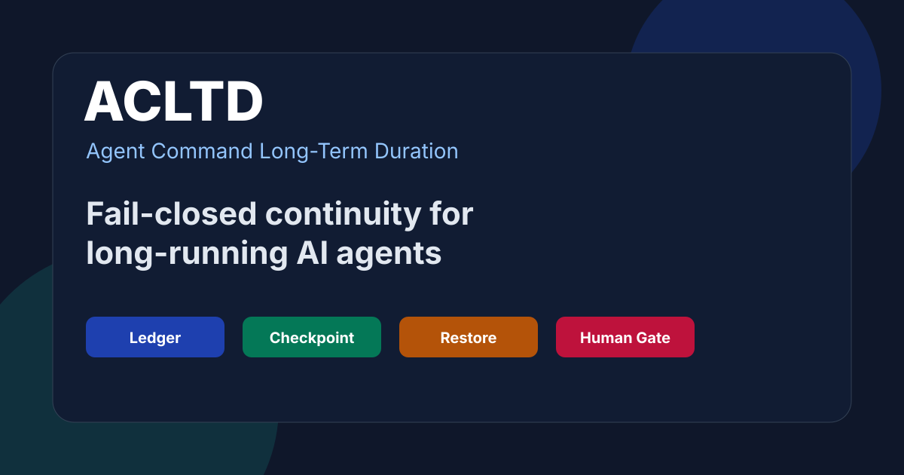
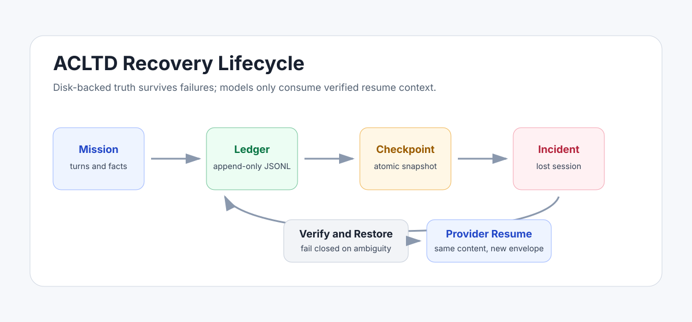
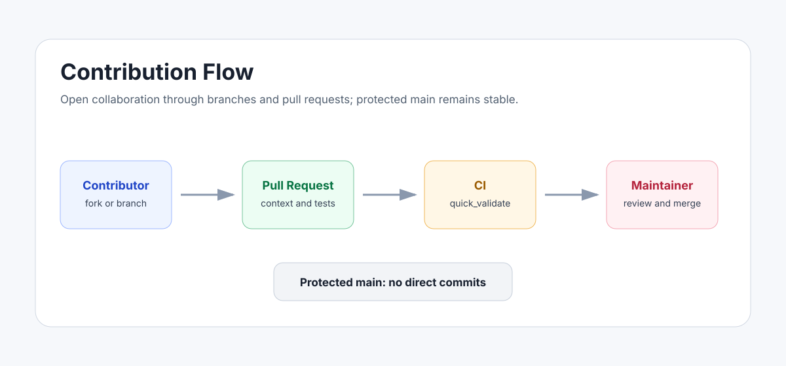

# ACLTD

**Agent Command Long-Term Duration**

ACLTD is a recovery-first continuity layer for long-running AI agent missions. It preserves operational state, decisions, constraints, open questions, gaps, and resumable checkpoints across process failures, terminal shutdowns, provider changes, model swaps, and session expiration.

It is not a generic memory feature. ACLTD is designed as deterministic, auditable, fail-closed continuity infrastructure.



[](https://github.com/Cfavini/acltd/actions/workflows/ci.yml)
[](https://github.com/Cfavini/acltd/actions/workflows/pages.yml)
[](LICENSE)
[](docs/RECOVERY_POLICY.md)
[](docs/MCP_ALIGNMENT.md)

## Why ACLTD Exists

Long-running agents fail in ordinary ways:

- the terminal closes;
- a process dies;
- RAM state disappears;
- the model or provider changes;
- a human handover is incomplete;
- a previous decision is contradicted after context loss;
- an action is repeated because the agent forgot it had already completed it.

ACLTD addresses those failures by making disk-backed, verifiable state the source of truth.

## Core Principle

```text
ACLTD is not ordinary long-term memory.
ACLTD is deterministic, auditable, fail-closed operational continuity.

MCP is an interface.
Ledger, checkpoint, and verifiable persistent records are the source of truth.
When in doubt, declare the gap and ask the human.
Never invent state.
Never presume success.
Never advance without authorization.
```

## What It Provides

| Capability | Purpose |
| --- | --- |
| Append-only JSONL ledger | Records turns, facts, decisions, gaps, notes, and checkpoint phases |
| SHA-256 hash chain | Detects tampering and rollback attempts |
| Atomic checkpoint writes | Supports recovery after interrupted writes |
| Pinned facts with sources | Prevents unsupported reconstruction of state |
| Provider-neutral resume | Rebuilds equivalent context across OpenAI-like, Anthropic-like, LM Studio, Ollama, Tencent, and Nous envelopes |
| Fail-closed restore | Refuses malformed, corrupted, rolled-back, or under-specified state |
| Human authorization flag | Keeps external action authority outside the agent |

## Current Status

ACLTD v1.4.4 is **technically approved for optional pilot and homologation**, not production installation.

The audited skill package lives in:

```text
skill/acltd/
```

Validation command:

```bash
cd skill/acltd/scripts
python quick_validate.py
```

Expected result:

```text
PASS manifesto
PASS py_compile
PASS ascii_ps51
PASS selftest
{"ok": true, ...}
```

## Architecture



ACLTD treats models as consumers of recovered context, not as authorities over state.

See [Architecture](docs/ARCHITECTURE.md) and [Recovery Policy](docs/RECOVERY_POLICY.md).

## MCP Alignment

ACLTD is designed to align with MCP as a future interface boundary:

- Resources may expose read-only recovery state.
- Prompts may package safe resume instructions.
- Tools may validate, checkpoint, or restore only under explicit human authorization.

See [MCP Alignment](docs/MCP_ALIGNMENT.md).

## Repository Policy

This project welcomes open-source collaboration through issues, discussions, branches, forks, and pull requests. Direct commits to `main` are not allowed.

All changes must go through review, CI, and maintainer approval.



Start here:

- [Contributing](CONTRIBUTING.md)
- [Governance](GOVERNANCE.md)
- [Security](SECURITY.md)
- [Publication and SEO Guide](docs/PUBLICATION_GUIDE.md)

## Suggested GitHub Topics

```text
ai-agents
agent-memory
agent-continuity
mcp
model-context-protocol
long-running-agents
checkpointing
recovery
fail-closed
auditability
jsonl
hash-chain
hermes-agent
nous-research
```

## License

MIT License. See [LICENSE](LICENSE).
