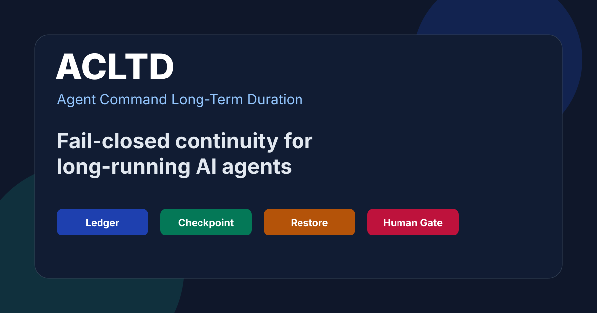
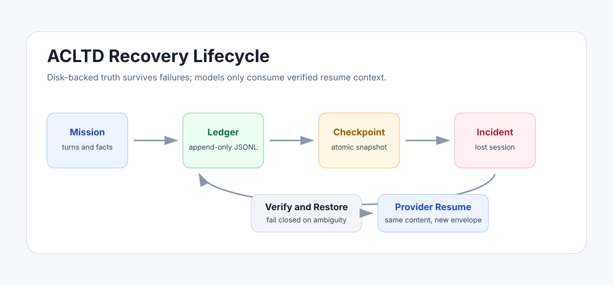
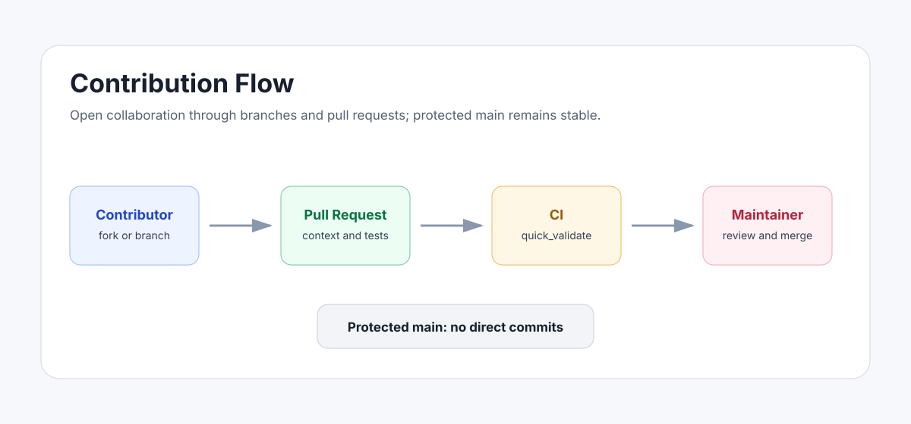

# ACLTD

**Agent Command Long-Term Duration**

ACLTD is a recovery-first continuity layer for long-running AI agent missions. It preserves operational state, decisions, constraints, open questions, gaps, and resumable checkpoints across process failures, terminal shutdowns, provider changes, model swaps, and session expiration.

It is not a generic memory feature. ACLTD is designed as deterministic, auditable, fail-closed continuity infrastructure.



[](https://github.com/CFavini/ACLTD/actions/workflows/ci.yml)
[](https://github.com/CFavini/ACLTD/actions/workflows/pages.yml)
[](LICENSE)
[](CHANGELOG.md)
[](docs/RECOVERY_POLICY.md)
[](docs/MCP_ALIGNMENT.md)

## Why ACLTD Exists

Long-running agents fail in ordinary ways:

- the terminal closes;
- a process dies;
- RAM state disappears;
- the model or provider changes;
- a human handover is incomplete;
- a previous decision is contradicted after context loss;
- an action is repeated because the agent forgot it had already completed it.

ACLTD addresses those failures by making disk-backed, verifiable state the source of truth.

## Core Principle

```text
ACLTD is not ordinary long-term memory.
ACLTD is deterministic, auditable, fail-closed operational continuity.

MCP is an interface.
Ledger, checkpoint, and verifiable persistent records are the source of truth.
When in doubt, declare the gap and ask the human.
Never invent state.
Never presume success.
Never advance without authorization.
```

## What It Provides

| Capability | Purpose |
| --- | --- |
| Append-only JSONL ledger | Canonical ASCII/LF history, including explicit repair and migration records |
| Keyed HMAC-SHA256 chain and anchor | Rejects forged history; mandatory caller key, never stored in journal |
| External head hooks | on_head and expected_head detect authentic whole-set rollback against external evidence |
| Exclusive OS ledger lock | Serializes writers, verification and whole checkpoint transactions; LedgerBusy timeout |
| Incremental append | Authenticates anchor and tail; full verification on mission opening and restore |
| Atomic two-phase checkpoint | Only latest confirmed or newest pending state can restore |
| Approved torn-tail repair | Removes only incomplete noncanonical tail bytes; audits size/hash/approver/reason |
| Pinned facts with sources | Preserves sourced facts and gaps as single-line trusted context |
| Provider-neutral resume | Six identical system/user pairs; recovered summary/questions/turns are separate user data |
| Configurable approval | Required approver, requires_approval=true; external_action_allowed=0 |
| Optional cipher hooks | Base64 ciphertext for payload/state; no cipher dependencies or runtime test keys |
| Explicit legacy migration | Read-only 1.x verify; distinct 2.0 journal records the legacy head |

## Current Status

ACLTD **v2.0.0** is the current stable release. Accepted by the maintainer on 2026-11-25 after field tests on the target hardware: network loss, power loss and forced shutdown. Version 1.x is historical and supported only for read-only verification and explicit migration.

The audited skill package lives in:

```text
skill/acltd/
```

Validation command:

```bash
cd skill/acltd/scripts
python quick_validate.py
```

Expected result:

```text
PASS manifesto
PASS py_compile
PASS ascii_ps51
PASS selftest
{"ok": true, ...}
```

API calls require a caller-supplied bytes key (or callable); no key is loaded by
CLI or from environment defaults. See [adapter contract](docs/ARCHITECTURE.md),
[protocol](skill/acltd/references/PROTOCOLO_ACLTD.md) and
[validation summary](docs/VALIDATION.md). Data-level, identity/path, key
service, MCP and backup policies belong to integrating adapters, outside this core.

## Architecture



ACLTD treats models as consumers of recovered context, not as authorities over state.

See [Architecture](docs/ARCHITECTURE.md) and [Recovery Policy](docs/RECOVERY_POLICY.md).

## MCP Alignment

ACLTD is designed to align with MCP as a future interface boundary:

- Resources may expose read-only recovery state.
- Prompts may package safe resume instructions.
- Tools may validate, checkpoint, or restore only under explicit human authorization.

See [MCP Alignment](docs/MCP_ALIGNMENT.md).

## Repository Policy

This project welcomes open-source collaboration through issues, discussions, branches, forks, and pull requests. Direct commits to `main` are not allowed.

All changes must go through review, CI, and maintainer approval.



Start here:

- [Contributing](CONTRIBUTING.md)
- [Governance](GOVERNANCE.md)
- [Security](SECURITY.md)
- [Publication and SEO Guide](docs/PUBLICATION_GUIDE.md)

## Suggested GitHub Topics

```text
ai-agents
agent-memory
agent-continuity
mcp
model-context-protocol
long-running-agents
checkpointing
recovery
fail-closed
auditability
jsonl
hash-chain
hermes-agent
nous-research
```

## License

MIT License. See [LICENSE](LICENSE).
