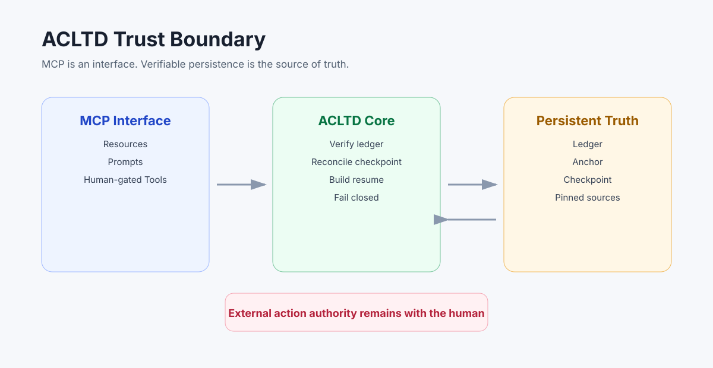

# Architecture

ACLTD separates recovery state from model context.

The model may receive a reconstructed resume, but it does not own the truth. The source of truth is the verified ledger, checkpoint, and anchor set on disk.

## Components

| Component | Responsibility |
| --- | --- |
| Ledger | Append-only JSONL history of turns, facts, decisions, gaps, notes, and checkpoint phases |
| Anchor | Atomic top-of-ledger marker used to detect rollback and delayed heads |
| Checkpoint | Atomic state snapshot for mission restoration |
| Resume Builder | Reconstructs compact provider-neutral mission context |
| Provider Envelope | Adapts the same recovered content to provider message formats |
| Human Authorization | Keeps completion and external action authority outside the agent |

## Recovery Flow

1. Verify the ledger byte-for-byte.
2. Verify the anchor.
3. Reconcile checkpoint intent and commit phases.
4. Validate pinned facts, gaps, turns, provider, and state hash.
5. Build resume text.
6. Convert the resume to the selected provider envelope.
7. Require the agent to confirm mission, pinned facts, and gaps before acting.

## Failure Behavior

ACLTD must refuse recovery when state is malformed, ambiguous, rolled back, corrupted, or unsupported.

The correct failure mode is not "best effort." The correct failure mode is a clear gap report requiring human decision.

## Design Boundary

ACLTD does not decide what the agent should do next. It reconstructs what the agent may safely know before doing anything next.
